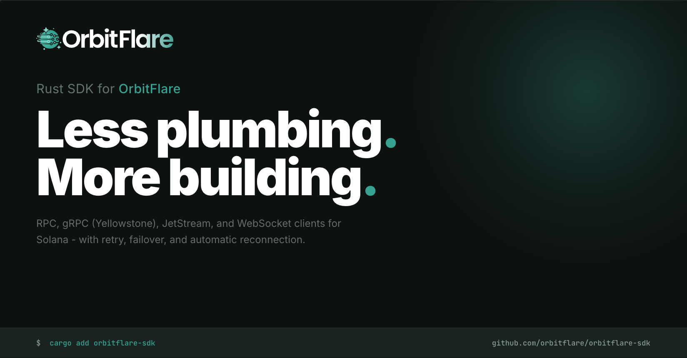

<p align="center">
  
</p>

<p align="center">
  <a href="https://crates.io/crates/orbitflare-sdk"></a>
  <a href="https://docs.orbitflare.com/sdk/overview"></a>
</p>

# orbitflare-sdk

Rust SDK for [OrbitFlare](https://orbitflare.com) - RPC, gRPC (Yellowstone Geyser), JetStream, and WebSocket clients for Solana.

## Install

```bash
cargo add orbitflare-sdk
```

Only the RPC client is enabled by default. Enable what you need:

```bash
cargo add orbitflare-sdk --features grpc         # gRPC streaming (Yellowstone Geyser)
cargo add orbitflare-sdk --features jetstream    # JetStream streaming
cargo add orbitflare-sdk --features ws           # WebSocket subscriptions
cargo add orbitflare-sdk --features tls          # https:// gRPC and JetStream endpoints
cargo add orbitflare-sdk --features all          # Everything
```

Or in your `Cargo.toml`:

```toml
[dependencies]
orbitflare-sdk = "0.4.1"                                          # RPC only (default)
orbitflare-sdk = { version = "0.4.1", features = ["grpc"] }       # gRPC
orbitflare-sdk = { version = "0.4.1", features = ["all"] }        # Everything
```

## RPC

```rust
use orbitflare_sdk::{RpcClientBuilder, Result};
use serde_json::json;

#[tokio::main]
async fn main() -> Result<()> {
    let client = RpcClientBuilder::new()
        .url("http://ny.rpc.orbitflare.com")
        .commitment("confirmed")
        .build()?;

    let slot = client.get_slot().await?;
    let balance = client.get_balance("CKs1E69a2e9TmH4mKKLrXFF8kD3ZnwKjoEuXa6sz9WqX").await?;
    let (blockhash, last_valid) = client.get_latest_blockhash().await?;

    let inflation = client.request("getInflationRate", json!([])).await?;

    let raw = client
        .request_raw(r#"{"jsonrpc":"2.0","id":1,"method":"getHealth","params":[]}"#)
        .await?;

    Ok(())
}
```

### Typed helpers

| Method | Returns |
|---|---|
| `get_slot()` | Current slot (`u64`) |
| `get_balance(address)` | Lamports (`u64`) |
| `get_account_info(address)` | Account data or `None` |
| `get_multiple_accounts(addresses)` | Vec of accounts (auto-chunks to 100) |
| `get_latest_blockhash()` | `(blockhash, last_valid_block_height)` |
| `get_transaction(signature)` | Full transaction with metadata |
| `get_signatures_for_address(address, limit)` | Recent signatures |
| `get_program_accounts(program_id)` | All accounts owned by a program |
| `get_recent_prioritization_fees(addresses)` | Recent priority fees |
| `send_transaction(tx_base64)` | Signature string |
| `simulate_transaction(tx_base64)` | Simulation result |
| `get_token_accounts_by_owner(owner, mint, program)` | Token accounts |
| `get_transactions_for_address(address, options)` | Full transaction history with filters and pagination (OrbitFlare-specific) |
| `request(method, params)` | Any RPC method by name |
| `request_raw(body)` | Raw JSON-RPC body string |

## DAS API

The Digital Asset Standard methods read NFTs, compressed NFTs, MPL Core assets and SPL tokens. They are on `RpcClient` and use the same endpoint, with typed requests and responses in `orbitflare_sdk::das`.

```rust
use orbitflare_sdk::das::{DisplayOptions, GetAssetsByGroup, GetAssetsByOwner, SearchAssets, TokenType};
use orbitflare_sdk::{RpcClientBuilder, Result};

#[tokio::main]
async fn main() -> Result<()> {
    let client = RpcClientBuilder::new()
        .url("https://fra.rpc.orbitflare.com")
        .build()?;

    let asset = client.get_asset("GJfYbfW7gufzFYfm8gFatrUE71wYsjay6FwzDkTa3vaD").await?;
    println!("{:?} owned by {:?}", asset.name(), asset.owner());

    let portfolio = client
        .get_assets_by_owner(
            &GetAssetsByOwner::new("86xCnPeV69n6t3DnyGvkKobf9FdN2H9oiVDdaMpo2MMY")
                .options(DisplayOptions::new().show_fungible(true).show_native_balance(true)),
        )
        .await?;

    let tokens = client
        .search_assets(&SearchAssets::new().owner("86xCnPeV69n6t3DnyGvkKobf9FdN2H9oiVDdaMpo2MMY").token_type(TokenType::Fungible))
        .await?;

    // Every asset in a collection, page by page.
    let all = client
        .pages(GetAssetsByGroup::collection("CDDyz6MHYY8972DPCXiEeReCxGqJSCbxHnimrvoyWrFF"))
        .collect_items()
        .await?;

    Ok(())
}
```

| Method | Returns |
|---|---|
| `get_asset(id)` | `Asset` |
| `get_asset_batch(ids)` | `Vec<Option<Asset>>` in request order (auto-chunks to 1,000) |
| `get_asset_proof(id)` | `AssetProof` for a compressed asset |
| `get_asset_proof_batch(ids)` | Proofs keyed by asset ID (auto-chunks to 1,000) |
| `get_asset_with_proof(id)` | Asset and proof in one call, for Bubblegum instructions |
| `get_assets_by_owner(req)` | `AssetList`, with `native_balance` when asked |
| `get_assets_by_group(req)` | `AssetList` |
| `get_assets_by_creator(req)` | `AssetList` |
| `get_assets_by_authority(req)` | `AssetList` |
| `search_assets(req)` | `AssetList` |
| `get_token_accounts(req)` | `TokenAccountList`, by owner, mint or both |
| `get_nft_editions(req)` | `NftEditions` of a master edition |
| `get_signatures_for_asset(req)` | `AssetSignatures` (signature and instruction pairs) |
| `pages(req)` | Walks every page of a list request, by cursor or page number |

`get_asset`, `get_asset_batch` and `get_asset_with_proof` have `_with_options` variants that take `DisplayOptions`. Requests take `.page()`, `.limit()`, `.cursor()`, `.before()`, `.after()` and `.sort_by()`; use one paging style per request.

## gRPC (Yellowstone Geyser)

Subscribe using a YAML config file:

```yaml
# grpc.yml
transactions:
  pumpfun:
    vote: false
    failed: false
    account_include:
      - "6EF8rrecthR5Dkzon8Nwu78hRvfCKubJ14M5uBEwF6P"

commitment: confirmed
```

```rust
use orbitflare_sdk::{GeyserClientBuilder, Result};
use orbitflare_sdk::proto::geyser::subscribe_update::UpdateOneof;

#[tokio::main]
async fn main() -> Result<()> {
    let client = GeyserClientBuilder::new()
        .url("http://ny.rpc.orbitflare.com:10000")
        .build()?;

    let mut stream = client.subscribe_yaml("grpc.yml")?;

    while let Some(update) = stream.next().await {
        let update = update?;
        if let Some(UpdateOneof::Transaction(tx)) = update.update_oneof {
            println!("slot={}", tx.slot);
        }
    }

    Ok(())
}
```

The YAML format supports `${ENV_VAR}` expansion.

### Typed filters

Build the request programmatically with the typed builder instead of YAML:

```rust
use orbitflare_sdk::grpc::{
    AccountFilter, Commitment, Lamports, Memcmp, SlotFilter, SubscribeRequestBuilder,
    TransactionFilter,
};

let request = SubscribeRequestBuilder::new()
    .transactions(
        "pumpfun",
        TransactionFilter::new()
            .vote(false)
            .failed(false)
            .account_include(["6EF8rrecthR5Dkzon8Nwu78hRvfCKubJ14M5uBEwF6P"])
            .account_required(["So11111111111111111111111111111111111111112"]),
    )
    .accounts(
        "wsol-token-accounts",
        AccountFilter::new()
            .owner(["TokenkegQfeZyiNwAJbNbGKPFXCWuBvf9Ss623VQ5DA"])
            .datasize(165)
            .memcmp(Memcmp::base58(0, "So11111111111111111111111111111111111111112"))
            .lamports(Lamports::Gt(0)),
    )
    .slots("slots", SlotFilter::new().filter_by_commitment(true))
    .commitment(Commitment::Confirmed)
    .build();

let mut stream = client.subscribe(request);
```

`client.subscribe(request)` also accepts a raw proto `SubscribeRequest` if you'd rather construct it by hand.

### Block footers

Alpenglow block footers arrive as their own `UpdateOneof::BlockFooter` update as soon as the validator reports them, without waiting for the block. Join them with other per-block updates on `(slot, bank_id)`. Certificates are opt-in, and their BLS signatures are not verified:

```rust
use orbitflare_sdk::grpc::{BlockFooterFilter, Commitment, SubscribeRequestBuilder};
use orbitflare_sdk::proto::geyser::subscribe_update::UpdateOneof;

let request = SubscribeRequestBuilder::new()
    .block_footer("footers", BlockFooterFilter::new().include_certificates(true))
    .commitment(Commitment::Processed)
    .build();

let mut stream = client.subscribe(request);
while let Some(update) = stream.next().await {
    if let Some(UpdateOneof::BlockFooter(footer)) = update?.update_oneof {
        println!("slot={} bank_id={} final_cert={}", footer.slot, footer.bank_id, footer.block_final_cert.is_some());
    }
}
```

### Resuming after a reconnect

`subscribe` sends the same request on every reconnect. `subscribe_with` builds the request for each connection instead, so a reconnect can resume from where the stream left off and pick up your current filters. The callback gets the endpoint, the attempt number, whether this is a reconnect, and the highest slot the stream has seen:

```rust
const JUPITER: &str = "JUP6LkbZbjS1jKKwapdHNy74zcZ3tLUZoi5QNyVTaV4";
const PUMP: &str = "6EF8rrecthR5Dkzon8Nwu78hRvfCKubJ14M5uBEwF6P";

let mut stream = client.subscribe_with(|info| {
    let mut request = SubscribeRequestBuilder::new()
        .transactions("swaps", TransactionFilter::new().vote(false).account_include([JUPITER]))
        .commitment(Commitment::Confirmed)
        .build();
    request.from_slot = info.last_slot.map(|slot| slot.saturating_sub(32));
    request
});
```

When a request sets `from_slot`, the stream first asks the server how far back it can replay. A slot older than that starts at the oldest available one, and a server without replay starts live, instead of failing the subscription. Both are reported as connection events (below).

### Changing filters on a live stream

Yellowstone applies a new request on an open stream in place of the previous one, so filters can change without reconnecting and without missing anything in between. `update` sends one; `handle()` gives a cloneable handle that works from any task:

```rust
let handle = stream.handle();
handle.update(
    SubscribeRequestBuilder::new()
        .transactions("swaps", TransactionFilter::new().vote(false).account_include([JUPITER, PUMP]))
        .build(),
)?;
```

`from_slot` is ignored on an update. A stream opened with `subscribe` keeps the updated request for later reconnects; one opened with `subscribe_with` calls its callback, which should reflect the change.

## JetStream

```yaml
# jetstream.yml
transactions:
  raydium:
    account_include:
      - "675kPX9MHTjS2zt1qfr1NYHuzeLXfQM9H24wFSUt1Mp8"
```

```rust
use orbitflare_sdk::{JetstreamClientBuilder, Result};
use orbitflare_sdk::proto::jetstream::subscribe_update::UpdateOneof;

#[tokio::main]
async fn main() -> Result<()> {
    let client = JetstreamClientBuilder::new()
        .url("http://ny.jetstream.orbitflare.com")
        .build()?;

    let mut stream = client.subscribe_yaml("jetstream.yml")?;

    while let Some(update) = stream.next().await {
        let update = update?;
        if let Some(UpdateOneof::Transaction(tx)) = update.update_oneof {
            println!("slot={}", tx.slot);
        }
    }

    Ok(())
}
```

Or build the request with the typed builder:

```rust
use orbitflare_sdk::jetstream::{SubscribeRequestBuilder, TransactionFilter};

let request = SubscribeRequestBuilder::new()
    .transactions(
        "pumpfun",
        TransactionFilter::new()
            .account_include(["6EF8rrecthR5Dkzon8Nwu78hRvfCKubJ14M5uBEwF6P"])
            .account_required(["So11111111111111111111111111111111111111112"]),
    )
    .build();

let mut stream = client.subscribe(request);
```

### JetStream v2

v2 (`jetstream::v2`) runs on the same endpoint and auth as v1 and is fully additive. Filters are managed at runtime over a bidirectional stream (no reconnect to change them), every response carries a monotonic `sequence` for gap detection, slot lifecycle events are a separate stream, and transactions can opt into enrichment (fee payer, program ids, compute-unit price, loaded address-table addresses, and more).

```rust
use orbitflare_sdk::jetstream::v2::{JetstreamClientBuilder, TransactionFilter};
use orbitflare_sdk::proto::jetstream::v2::subscribe_transactions_response::Payload;
use orbitflare_sdk::Result;

#[tokio::main]
async fn main() -> Result<()> {
    let client = JetstreamClientBuilder::new()
        .url("http://ny.jetstream.orbitflare.com")
        .build()?;

    println!("version={}", client.get_version().await?);

    let filter = TransactionFilter::new()
        .account_include(["6EF8rrecthR5Dkzon8Nwu78hRvfCKubJ14M5uBEwF6P"])
        .include_enrichment(true)
        .with_id("pumpfun");

    let mut stream = client.subscribe_transactions(vec![filter]);

    while let Some(resp) = stream.next().await {
        match resp?.payload {
            Some(Payload::Transaction(ft)) => {
                if let Some(tx) = &ft.transaction {
                    println!("slot={} cu_price={}", tx.slot, tx.compute_unit_price);
                }
            }
            Some(Payload::FilterValidation(r)) => {
                println!("filter {} accepted={}", r.filter_id, r.accepted);
            }
            _ => {}
        }
    }

    Ok(())
}
```

Add or remove filters on a live stream without reconnecting:

```rust
let handle = stream.handle();
handle.add_filters(vec![
    TransactionFilter::new().account_include(["..."]).with_id("raydium"),
])?;
handle.remove_filters(vec!["pumpfun".to_string()])?;
```

Slot lifecycle events are a separate server stream:

```rust
let mut slots = client.subscribe_slots();
while let Some(event) = slots.next().await {
    let event = event?;
    println!("slot={} status={:?}", event.slot, event.status());
}
```

Opt into Alpenglow block footers on the same stream. They arrive as `SlotStatus::BlockFooter` events, at most once per slot, and are not ordered relative to `Complete`. The certificates' BLS signatures are not verified, so treat a footer as the leader's claim, not proof of finality:

```rust
use orbitflare_sdk::proto::jetstream::v2::SlotStatus;

let mut slots = client.subscribe_slots_with_block_footers();
while let Some(event) = slots.next().await {
    let event = event?;
    if event.status() == SlotStatus::BlockFooter {
        if let Some(footer) = &event.block_footer {
            println!("slot={} bank_hash={:?}", footer.slot, footer.bank_hash);
        }
    }
}
```

## WebSocket

```rust
use orbitflare_sdk::{WsClientBuilder, Result};

#[tokio::main]
async fn main() -> Result<()> {
    let client = WsClientBuilder::new()
        .url("ws://ny.rpc.orbitflare.com")
        .build()
        .await?;

    let mut sub = client.slot_subscribe().await?;

    while let Some(slot) = sub.next().await {
        println!("{slot}");
    }

    Ok(())
}
```

Subscription types: `account_subscribe`, `logs_subscribe`, `slot_subscribe`, `signature_subscribe`. All auto-resubscribe on reconnect.

## Endpoint failover

All clients support multiple endpoints with automatic failover and health tracking.

```rust
let client = RpcClientBuilder::new()
    .urls(&[
        "http://ny.rpc.orbitflare.com",
        "http://fra.rpc.orbitflare.com",
        "http://ams.rpc.orbitflare.com",
    ])
    .build()?;
```

Failing endpoints are quarantined with exponential cooldown (10s, 20s, 40s, max 60s) and automatically retried once the cooldown expires. Healthy endpoints are always preferred.

## Retry

RPC calls retry on transient errors (5xx, 429, connection resets, Solana error codes -32005, -32007, -32014, -32015, -32016) with exponential backoff before failing over to the next endpoint. 429 responses with a `Retry-After` header are respected.

gRPC, JetStream, and WebSocket connections use active ping/pong to detect dead connections. Configurable via the builder:

```rust
let client = GeyserClientBuilder::new()
    .url("http://ny.rpc.orbitflare.com:10000")
    .ping_interval_secs(15)   // send a ping every 15s (default: 10)
    .max_missed_pongs(5)      // kill connection after 5 missed pongs (default: 3)
    .build()?;
```

All three streaming clients reconnect automatically on disconnection. WebSocket also re-subscribes all active subscriptions after reconnecting.

Configure retry behavior:

```rust
use orbitflare_sdk::RetryPolicy;
use std::time::Duration;

let client = RpcClientBuilder::new()
    .url("http://ny.rpc.orbitflare.com")
    .retry(RetryPolicy {
        initial_delay: Duration::from_millis(200),
        max_delay: Duration::from_secs(15),
        multiplier: 2.0,
        max_attempts: 5,
    })
    .build()?;
```

### Connection events

Reconnects are invisible in the update stream itself. Every gRPC and JetStream stream (v1 and v2, transactions and slots) also reports its connection lifecycle, for health checks, metrics, or deciding a gap needs backfilling:

```rust
use orbitflare_sdk::ConnectionEvent;

let mut events = stream.events();
tokio::spawn(async move {
    while let Some(event) = events.recv().await {
        match event {
            ConnectionEvent::Connecting { endpoint, attempt } => println!("connecting to {endpoint} (try {attempt})"),
            ConnectionEvent::Connected { endpoint } => println!("streaming from {endpoint}"),
            ConnectionEvent::Disconnected { endpoint, error, retry_in } => match retry_in {
                Some(delay) => println!("{endpoint} dropped ({error}); retrying in {delay:?}"),
                None => println!("{endpoint} dropped ({error}); giving up"),
            },
            ConnectionEvent::ReplayClamped { requested, available } => println!("slots {requested}..{available} are no longer replayable"),
            ConnectionEvent::ReplayUnavailable { requested } => println!("no replay; started live instead of at {requested}"),
            ConnectionEvent::Lagged { missed } => println!("missed {missed} events"),
            _ => {}
        }
    }
});
```

Events never hold the stream back: a reader that falls behind gets `Lagged` instead. The first call to `events()` also returns what happened before it was called.

### Connection settings

gRPC and JetStream connections send HTTP/2 keepalive pings, and accept messages up to 64 MiB (tonic's own default of 4 MiB rejects some blocks). Change the limit with `.max_decoding_message_size(bytes)` on the builder. `https://` endpoints need the `tls` feature.

## Environment variables

| Variable | Used by | Purpose |
|---|---|---|
| `ORBITFLARE_LICENSE_KEY` | All clients | API key: appended to RPC and WebSocket URLs, sent as `x-token` to gRPC and JetStream |
| `ORBITFLARE_RPC_URL` | RPC | Default endpoint if `.url()` is not called |
| `ORBITFLARE_WS_URL` | WebSocket | Default endpoint if `.url()` is not called |
| `ORBITFLARE_GRPC_URL` | gRPC | Default endpoint if `.url()` is not called |
| `ORBITFLARE_JETSTREAM_URL` | JetStream | Default endpoint if `.url()` is not called |
